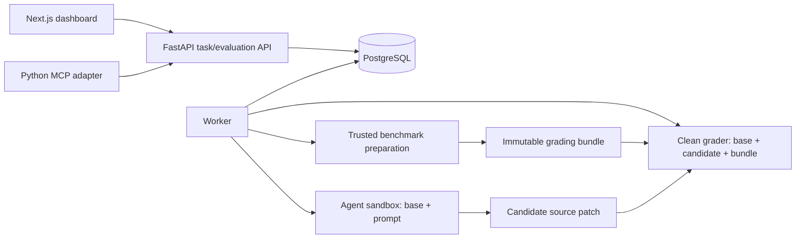

# AgentBench architecture

AgentBench evaluates coding agents against immutable historical-fix benchmarks.
This starter defines contracts, process boundaries and an interactive demo;
persistence and real execution remain future work.

## Task, evaluation and run

A **benchmark task** pins a public repository, full base/reference commit SHAs,
natural-language prompt, reference grading paths, required fail-to-pass and
pass-to-pass test IDs, grading command and digest-pinned runtime/setup commands.
A task ID identifies an immutable specification; edits create a new ID and require
new validation. An **evaluation** selects a validated task and models. A **run**
is one agent/model attempt against that exact task snapshot.

The reference commit supplies trusted tests/fixtures and validates the known-good
behavior. It never supplies the candidate implementation. Agent inputs are limited
to base code and prompt; reference SHA, future Git history, reference solution,
grading bundle and validation logs remain evaluator-only.

## Components

Arrows describe the intended implementation.

- **Backend:** validate request shape, persist immutable tasks, enqueue validation
  and evaluations, and serve evidence/artifacts. SQLAlchemy/Alembic will manage
  PostgreSQL models and migrations. Reject unknown task IDs with 404 and tasks
  without valid evidence with 409 before queuing model runs.
- **Trusted preparation:** resolve both Git objects; extract selected reference
  test/fixture paths into a checksummed manifest. Test the same bundle on clean
  base and reference checkouts. Verify expected failures are assertion failures,
  not broken dependency setup or collection. Require every named test to execute.
- **Worker:** claim durable jobs, enforce budgets, orchestrate preparation/agent/
  grading boundaries and store events, patches, usage and results. Run lifecycle:
  `queued → preparing → running → grading → completed`, with failure/cancellation
  exits. Completed means grading finished, not that the task was solved.
- **Agent sandbox:** expose a base-only repository snapshot and prompt. Remove
  future refs/history and block fetching the fix. Adapter tools act inside this
  sandbox. Provider secrets and the Docker socket stay on the trusted worker.
- **Grader:** reconstruct a fresh base checkout, apply allowed candidate source
  changes, install the trusted bundle, verify its digest and execute argv. Never
  reuse an agent-mutated test runner/environment as trusted grading evidence.
- **Frontend:** task authoring/catalog/evidence, evaluation submission, progress,
  logs, tests/diffs and matched-task comparisons. Currently uses explicit fictional
  sample data and session-only React state; no backend requests are made.
- **MCP:** official Python SDK, local stdio; create/get/list task definitions,
  request validation and create/get/list evaluations through the same HTTP API.
  This management surface must not be available to the evaluated agent.

## Grading and reproducibility

Task lifecycle: `unvalidated → validating → validated / rejected`. Only trusted
worker evidence can validate a task: fail-to-pass tests fail on base and pass on
reference; pass-to-pass tests pass on both. Infrastructure errors return an
unvalidated, retryable job outcome rather than proving a valid behavioral failure.

A candidate resolves the task when every required test passes. Missing, skipped,
collection-error or infrastructure-error outcomes cannot count as success. Keep
incorrect solutions separate from execution failures; keep token/cost metrics
null when unavailable. Test coverage remains a limitation, so prompts and test
bundles need review for unstated requirements and reference-specific assumptions.

Record the task specification hash, both commits, grading bundle hash, environment
image digest, agent version/configuration and model settings. Store local artifact
bytes plus PostgreSQL metadata initially. Add object storage when worker hosts
need shared artifacts. Comparisons must use matched immutable task IDs/cohorts.

## Scheduling and extension points

Begin with PostgreSQL job claiming using short `FOR UPDATE SKIP LOCKED`
transactions, leases/heartbeats and ownership-checked writes. Validation jobs and
agent runs are separate durable work items. Recover abandoned leases and give
retries separate attempt records. Add Redis/Celery when measured scheduling needs
justify a broker.

Execution protocols separate preparation, sandboxing, agents, event sinks and
grading. Enforce CPU/memory/process/disk/time limits, non-root containers, restricted
networking, cleanup and artifact retention. Docker alone is not a complete boundary
for hostile multi-tenant workloads; stronger sandbox hosts are an extension point.
Other additions include authentication/ownership, task imports (including SWE-bench),
more providers, cancellation, streaming and remote workers.

All task/evaluation routes currently return explicit HTTP 501 after input
validation. There is no database connection, extraction, validation worker, agent
loop, Docker execution or test grading. See [benchmark instructions](benchmarking.md)
for the implementation sequence and acceptance checks.

## References

- [SWE-bench task fields and test cohorts](https://huggingface.co/datasets/SWE-bench/SWE-bench_Verified/blob/main/README.md)
- [FastAPI application structure](https://fastapi.tiangolo.com/tutorial/bigger-applications/)
- [Next.js App Router](https://nextjs.org/docs/app/getting-started/installation)
- [Official Python MCP SDK](https://github.com/modelcontextprotocol/python-sdk)
- [Docker Engine security](https://docs.docker.com/engine/security/)
